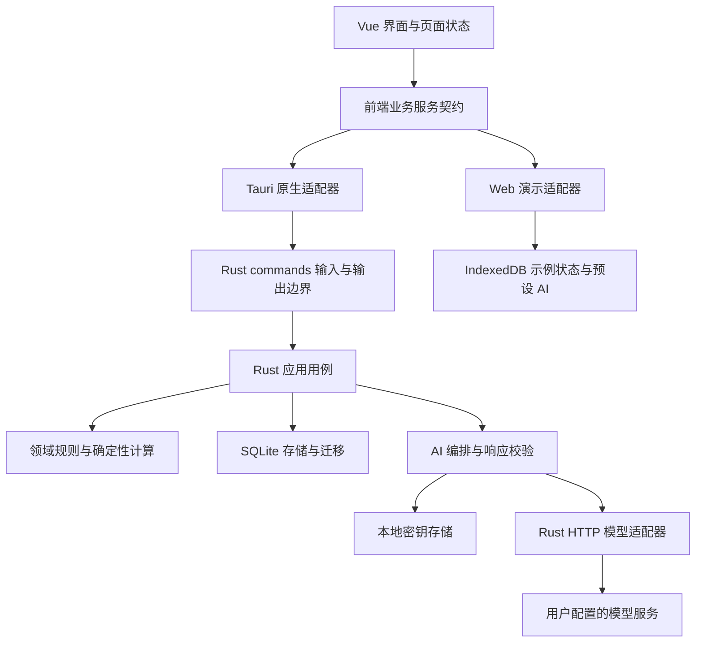
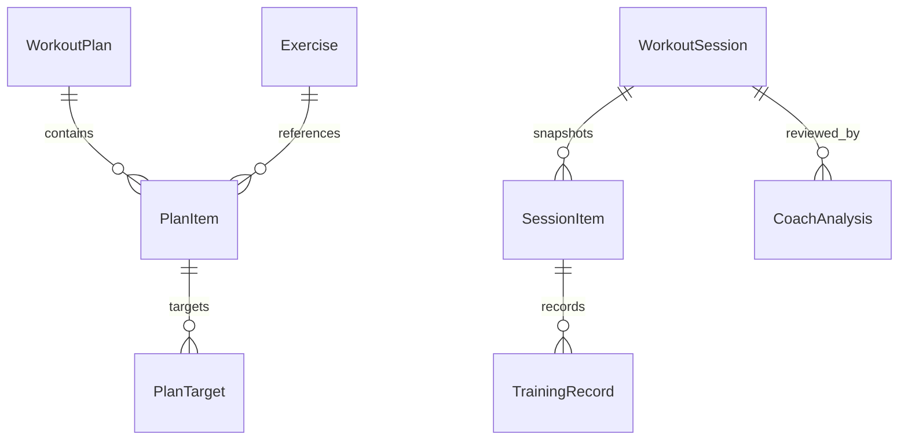

# TallyRep 整体架构方案

版本：0.1。日期：2026-10-29。负责人：架构与评审由助手承担，用户负责实现及产品取舍。

本文是后续实现的架构基线，不代表相关模块已经完成。需求范围见 [MVP](MVP.md)，执行与验收见 [交付计划](DELIVERY.md)。实现涉及尚未验证的平台能力时，先完成对应技术验证，再锁定依赖与配置。

## 产品边界与架构目标

TallyRep 面向个人力量与有氧训练，第一版覆盖动作选择、计划配置、训练记录、历史总结和 AI 复盘。先在 Windows 完成可实际使用的版本，再在 MVP 阶段集中验证 Android。长期目标是公开发行。

用户于 2026-10-29 明确：模型 URL、API 密钥由使用者配置，第一版不增加服务端；AI 范围为训练后复盘、下次建议、用户确认后调整计划。云同步属于后续独立阶段，当前不接 Supabase、不要求账号。

架构优先满足以下目标：

1. 核心记录离线可用；退出、异常终止或网络失败不能使已经确认保存的记录丢失。
2. 计划、实际完成情况和 AI 建议有明确边界，修改计划不改变历史事实。
3. 同一套 Vue 界面支持 Windows、Android 与可重置的 Web 演示。
4. 业务规则能脱离窗口测试，数据迁移、错误恢复和版本发布有验证依据。
5. 用户密钥只用于向其指定的模型端点发请求，不进入训练数据库、普通备份或日志。

不将“身体健康”做成一个未经数据支持的综合分数。首版展示训练日志可计算的事实和变化；体重、体围、设备健康数据作为之后的独立需求。

## 系统组成

采用单仓库、模块化客户端。Rust 是原生端业务规则和持久化的权威实现；Vue 负责交互、表单及状态展示。Web 演示通过相同的前端服务契约接入独立模拟实现。



外部模型服务是用户选择的第三方系统，不是 TallyRep 自建后端。客户端运行和记录训练不依赖它。Pages 构建不调用真实模型，也不要求输入真实密钥。

## 技术决策

| 事项 | 决策 | 取舍与约束 |
| --- | --- | --- |
| 应用形态 | Vue 3、TypeScript、Vite、Tauri 2、Rust | 保留现有基线，不重建项目 |
| 前端组织 | 按动作、计划、训练、历史、教练、设置拆分功能目录 | App.vue 只承载布局和路由，不继续堆积业务 |
| 路由 | Vue Router，首版 hash 模式 | 适配静态 Pages 和应用内导航；引入时验证现有工具链兼容性 |
| 页面共享状态 | Pinia 管理当前训练及应用设置视图 | 局部表单留在组件；Pinia 不是数据库，不保存模型密钥 |
| 本地存储 | SQLite，仅由 Rust 访问 | 支持事务、约束、迁移与历史查询；不向前端暴露 SQL 接口 |
| SQLite 访问 | 优先采用 rusqlite，编译携带 SQLite | 先验证 Windows 编译、事务与恢复；Android 的编译及存储行为在移动阶段验收 |
| 通信 | Tauri commands，明确请求和响应 DTO | 页面使用 service，不直接调用 invoke；错误统一编码 |
| AI 网络 | Rust reqwest，通过模型适配器访问用户端点 | 控制超时、重定向、响应长度和错误脱敏；不经 WebView 直接发送密钥 |
| 密钥持久化 | 加密密钥库与普通数据分离 | Stronghold 是优先验证候选；是否能满足 Rust 封装及移动平台要求要实测 |
| Web 演示 | 同一页面，独立 IndexedDB 示例存储 | 支持创建计划、记录和重置；不宣称与原生数据库同步 |
| 云端 | 第一版无应用服务端、账号和同步 | 之后再设计 Supabase 等托管同步，不预建空服务 |

Vue Router 的 hash 模式不依赖服务端路径回退，Pinia 用于跨页面共享状态，符合本项目的静态展示和训练中导航需要。[Vue Router](https://router.vuejs.org/guide/essentials/history-mode.html)、[Pinia](https://pinia.vuejs.org/introduction.html)

rusqlite 提供 Rust SQLite 访问和事务能力；连接实现 Send，但不是 Sync。数据库实现必须明确线程和同步边界。[rusqlite](https://docs.rs/rusqlite/latest/rusqlite/)、[Connection](https://docs.rs/rusqlite/latest/rusqlite/struct.Connection.html)

## 模块与目录

以下是目标结构，随任务逐步迁移，不一次创建空目录。保持一个 Rust crate；只有出现明确复用或编译隔离需求时再拆 workspace。

```text
src/
  app/                    路由、启动、布局、服务装配
  features/
    exercises/            动作列表与选择
    plans/                计划编辑
    training/             当前训练与记录
    history/              历史和确定性摘要
    coach/                分析展示与建议确认
    settings/             单位、模型配置、备份
  components/             确实跨功能复用的基础组件
  contracts/              请求、响应、错误的 TS 定义
  services/
    native/               Tauri commands 适配
    demo/                 示例用例和 IndexedDB 实现
    index.ts              选择运行环境并提供统一服务
  styles/                 主题变量与公共样式
src-tauri/
  src/
    lib.rs                Tauri 装配和命令注册
    commands/             DTO 解码、调用用例、错误映射
    application/          动作、计划、训练、教练、备份用例
    domain/               类型、规则、状态转换、计算
    infrastructure/
      db/                 SQLite 连接、查询、迁移执行
      ai/                 HTTP 与协议适配
      secrets/            密钥库封装
    contracts/            Serde DTO 与公开错误
  migrations/             有序且不可随意修改的 SQL 迁移
  tests/                  数据库与命令契约集成测试
fixtures/
  catalog/                唯一的内置动作数据来源
  contracts/              两端共同验证的序列化样例
  coach/                  合成的模型输入与响应测试集
docs/
  MVP.md
  ARCHITECTURE.md
  DELIVERY.md
  PROGRESS.md
```

依赖方向为 commands → application → domain；application 可调用基础设施提供的明确能力。domain 不导入 Tauri、数据库或 HTTP 类型。模型服务和密钥库因存在多实现及测试替身而定义接口；普通数据库操作先用具体 repository，不为每张表建立泛型框架。

## 产品页面与交互

| 页面 | 核心操作 | 必须处理的状态 |
| --- | --- | --- |
| 训练入口 | 继续未完成训练、从计划开始 | 无计划、有进行中训练、启动失败 |
| 动作库 | 搜索、筛选、查看记录方式、选入计划 | 空结果、加载失败、不支持的记录方式 |
| 计划 | 创建、改名、排序动作、设置目标、归档 | 未保存、保存中、失败、版本冲突 |
| 训练中 | 填实际值、完成或跳过一组、结束或放弃 | 未保存、保存成功、失败重试、恢复 |
| 历史 | 列表、详情、同动作变化、明确更正记录 | 空历史、已更正、AI 分析已过期 |
| AI 教练 | 预览发送内容、请求复盘、阅读和采纳建议 | 未配置、密钥锁定、进行中、取消、失败 |
| 设置 | 单位、模型端点与模型名、密钥、导出与恢复 | 不合法配置、连接失败、密钥已保存 |

窄屏以底部导航、足够大的触摸区域和单列记录为主；桌面提供更宽的列表或侧栏。输入数字时明确单位。保存状态必须真实反映持久化结果，不在仅修改内存后显示“已保存”。错误应保留用户输入并提供恢复操作。

## 领域与数据模型

### 动作与记录方式

Exercise 表示动作定义。category 继续区分 strength 和 cardio；另设 metricKind 表示记录方式，避免把“力量”误认为一定需要重量。

首版支持 weighted_reps（外部负重与次数）、reps（次数）、duration（时长）、distance_duration（距离与时长）。自重动作可用 reps；定时静力动作可用 duration。有氧的距离允许缺省，但不能把未知当成零。辅助重量、单侧换算和器械特殊计量作为后续明确需求处理。

内置动作由一份版本化的 catalog 文件提供，原生数据库和 Web 种子数据均从这里初始化，停止维护 Rust 与 TypeScript 两套手写列表。内置动作使用稳定 ID 与 seedKey；首版采用人工审阅的少量动作，图片与动作内容来源需要可发布的使用权。

### 实体关系

| 实体 | 核心字段与职责 |
| --- | --- |
| Exercise | id、seedKey、name、category、metricKind、archivedAt |
| WorkoutPlan | id、name、revision、createdAt、updatedAt、archivedAt |
| PlanItem | id、planId、exerciseId、position、动作与单位展示配置 |
| PlanTarget | id、planItemId、position、按 metricKind 区分的目标值 |
| WorkoutSession | id、sourcePlanId、sourcePlanRevision、status、startedAt、endedAt、revision、note |
| SessionItem | id、sessionId、position、来源动作 ID、动作名称和记录方式快照 |
| TrainingRecord | id、sessionItemId、position、目标快照、实际值、完成状态、备注 |
| CoachAnalysis | id、sessionId、sessionRevision、inputHash、promptVersion、providerProfileId、model、状态、经校验输出、时间 |
| ModelProfile | id、显示名、协议、baseUrl、model、超时设置、secretRef；不含密钥 |

PlanTarget 和 TrainingRecord 都是有类型的值：负重次数、次数、时长、距离时长。SQL 具体列及 CHECK 约束在数据模型任务中定稿，不把全部业务数据塞入一个自由 JSON 字段。



### 必须保持的规则

1. 开始训练时在一个事务中创建 session、动作快照和目标记录；之后计划更新或归档不改变它们。
2. 同一本地资料库同时最多一条 in_progress 训练。重复点击开始必须返回原结果或明确冲突，不能生成两次。
3. session 状态为 in_progress、completed、discarded；记录状态为 pending、completed、skipped。结束时存在 pending 项需要用户明确选择继续或将剩余项跳过。
4. 完成记录时验证对应 metricKind 的必要字段、单位、数值范围；负重可为零，次数和有效时长应大于零。无效值在 Rust 层拒绝。
5. 完成后的训练可通过明确的“更正记录”用例修改，revision 增加，摘要重算；旧 AI 分析标为过期。历史更正不悄悄修改计划。
6. 采纳 AI 建议先显示计划差异，再用 expectedRevision 写入。用户已经修改计划时返回冲突，不覆盖新版本。
7. 训练摘要由程序计算；同动作且计量方式相同时才能直接比较。没有记录的数据用未知表达，不推断身体健康状态。

### 单位与时间

持久化使用明确的基础单位：重量整数克、距离整数米、时长整数秒、次数整数。UI 负责公斤等显示转换，输入经校验和明确舍入后转为基础单位，避免把浮点计算误差写成训练事实。首版默认公斤和公里，单位扩展不改变已有记录含义。

实体 ID 使用客户端生成的 UUID 字符串；时间戳为 UTC 毫秒，训练保存开始时区偏移用于历史日期展示。活动时长显式保存，不能仅靠页面 setInterval 计数；恢复、跨日和系统时间变化需测试。每个可修改聚合保存 revision。上述字段方便后续迁移与同步，但并不构成同步协议。

## 存储与可靠性

数据库保存到 Tauri 解析的应用数据目录，不写到源码或安装目录。首版一个本地资料库，不建立多租户逻辑。普通训练数据库不宣称已加密，依赖操作系统用户隔离；密钥使用独立加密存储。

SQLite 初始化显式设置 foreign_keys=ON、busy_timeout，并选择经验证的 WAL 与 synchronous 策略。首版优先保证已确认写入的可靠性，采用 synchronous=FULL；性能优化必须有测量支持。外键需要逐连接启用。[SQLite 外键文档](https://www.sqlite.org/foreignkeys.html)

先使用单连接和清晰的串行写入边界：数据库操作放到阻塞任务中，使用受互斥保护的连接，数据库锁不跨 await，不在数据库事务中调用模型网络。增加连接池要由实际吞吐需要驱动。Tauri 托管状态可以用于持有应用服务。[Tauri 状态管理](https://v2.tauri.app/develop/state-management/)

每次用户确认一组记录即独立提交事务。保存按钮确认前若进程终止，未确认内容可能尚未持久化；界面区分这些状态。相同记录 ID 的重试使用幂等更新；开始训练使用 operationId 去重。写入失败不清空用户输入。

迁移用版本表记录执行序号和校验信息，应用在迁移成功后开放写入。失败保留原文件并进入恢复界面；旧版本遇到更高数据库版本停止写入。升级前通过一致性备份保留恢复点，不直接复制正在写入的数据库文件。[SQLite Backup API](https://www.sqlite.org/backup.html)

用户导出使用带 schemaVersion 的可移植数据包，包含计划、历史、动作和分析，默认排除模型配置及全部凭据。恢复先校验到临时库，显示范围，经确认后替换；首版不做自动合并。恢复前创建本地备份，失败时可回退。备份、恢复和迁移必须在个人真实使用前验证。

## 前后端契约

Rust DTO 是原生业务接口的权威定义，Serde 使用明确的 camelCase 字段和枚举字符串。TypeScript DTO 按契约同步；共享 JSON fixtures 分别由 Rust 序列化测试和前端契约测试验证。仅有 invoke 泛型不能证明边界数据合法。初期不引入自动类型生成链路，出现显著维护成本后再立决策记录。

首批服务契约按用例设计，不暴露通用 SQL 或任意文件操作：

| 用例 | 建议命令 | 核心行为 |
| --- | --- | --- |
| 动作查询 | list_exercises | 搜索、类别、分页参数；稳定顺序 |
| 计划编辑 | save_plan / archive_plan | expectedRevision；原子更新动作与目标 |
| 开始训练 | start_session | 计划快照、operationId、防重复 |
| 恢复训练 | get_active_session | 从数据库恢复完整状态 |
| 保存组 | save_training_record | 指定 ID 与 revision，返回已持久化结果 |
| 完成训练 | finish_session | 校验状态、剩余项处理、摘要 |
| 历史更正 | correct_session | 提升 revision、使旧分析过期 |
| 请求复盘 | analyze_session / cancel_analysis | 输入预览标识、任务状态、取消 |
| 采纳建议 | apply_coach_suggestion | 预览后的明确变更、版本校验 |
| 模型配置 | save_model_profile / set_model_secret | 普通配置与密钥分开，只返回掩码状态 |
| 数据迁移 | export_data / restore_data | 受控路径、格式校验和原子恢复 |

commands 返回 Result<T, AppError>，公开错误包含 code、message、可选 field 和 retryable。代码至少区分 VALIDATION、NOT_FOUND、CONFLICT、STORAGE、SECRET_LOCKED、MODEL_AUTH、MODEL_TIMEOUT、MODEL_RATE_LIMIT、MODEL_RESPONSE_INVALID。内部 SQL、密钥、Authorization 和完整模型响应不直接进入用户错误。Tauri 支持可序列化返回值和命令错误。[Tauri commands](https://v2.tauri.app/develop/calling-rust/)

页面状态不只用一个全局 loading；列表、保存、分析各自拥有 idle/loading/success/error 状态。请求结果按请求 ID 或 revision 处理，过时结果不覆盖新状态。

## 用户配置模型与 AI 教练

### 协议范围

用户填写 baseUrl、model 和 API key。第一版采用 OpenAI Chat Completions 兼容协议的一个明确子集：文本 messages、非流式响应、读取返回文本。以 API 根路径为 baseUrl，规范化后附加 chat/completions；不盲目补多次 v1。表单展示解析后的目标地址，模型名允许手填，不要求供应商提供模型列表接口。

这是面向多供应商的兼容性选择，不意味着所有模型 URL 都可直接使用。不同协议通过后续 provider adapter 扩展；Responses 或厂商原生协议不静默假装兼容。Chat Completions 的字段以官方接口为参照，实际供应商需通过契约与真实调用验证。[OpenAI Docs](https://developers.openai.com/api/reference/resources/chat)

reqwest 客户端默认只允许合法 HTTPS URL，不接受 URL 中的用户名、密码或密钥查询参数；首版不支持明文 HTTP 本地模型端点，若用户需要则作为单独能力设计。关闭自动重定向，避免意外请求非配置端点；保持 TLS 校验。超时、响应体大小、同时请求数都有上限。禁用证书验证不能成为处理连接问题的方法。[reqwest 重定向策略](https://docs.rs/reqwest/latest/reqwest/redirect/struct.Policy.html)

### 密钥生命周期

密钥仅在设置表单输入后传给 Rust 存储命令，成功后清除表单状态。读取配置只返回 hasSecret 等元信息，不提供“读取原始密钥”的通用前端接口。普通状态管理、SQLite、浏览器存储和日志均不保存密钥。

优先验证 Stronghold 或其 Rust 核心封装，实现以用户本地解锁口令打开加密密钥库。口令或等价解锁密钥不能与密钥库明文并存；首次使用及进程重启后解锁，用户可主动锁定，退出时释放会话内凭据。忘记口令可重置模型密钥库并重新配置，不影响训练数据库。不承诺在受控或已被攻破的设备上完全消除内存读取风险。

Stronghold 文档提供密码派生及密钥存储能力，但不是本项目的验证结果。Windows 的 Rust 封装、错误口令和重启恢复在 AI 开发前验证；Android 的密钥保存、锁定与恢复在移动里程碑单独验收。若库无法满足边界，提交替代方案，不能退化为明文保存。[Tauri Stronghold](https://v2.tauri.app/plugin/stronghold/)

用户可以选择“仅本次使用”，此时凭据不落盘。更换端点时必须重新确认或输入密钥，不能把原供应商密钥自动发送给新地址。数据导出和未来训练同步均排除密钥。

### 分析过程

1. Rust 从本次和用户选择的有限历史中生成确定性摘要，标记单位、缺失值及记录版本。
2. 页面显示发送范围和目标服务；用户主动确认一次分析请求。训练备注默认不发送，可单独选择包含。
3. 固化 inputHash、sessionRevision、promptVersion、provider profile 和 model，创建分析任务；网络请求不持有数据库锁。
4. 将输入作为数据传递，提示词要求结构化的总结、证据引用、下次建议及待补充信息。日志和备注中的指令不具备工具权限。
5. Rust 校验响应结构、枚举、长度、数值、引用的动作和记录 ID。供应商支持结构化输出时可启用；无论供应商承诺如何，都要本地校验。
6. 合法结果保存并展示。格式错误显示失败，不把未验证文字直接转换成计划命令，也不使用正则猜测变更。
7. 用户选择具体建议后预览变更，经过领域校验和版本检查，在单个事务中更新计划；保存建议采纳记录。

AI 只形成候选建议，没有 SQL、文件、任意 URL 或自动执行计划的工具权限。遇到数据不足明确提出问题，不生成身体疾病诊断。首版不包含自由聊天、自动初始计划生成、视频姿态识别或自主连续执行。

同一 sessionRevision 的重复分析可展示缓存并允许明确重算。请求设置上限与取消入口，终止本地等待不保证远端模型停止计费。超时后不自动重试有费用的请求，由用户决定重试；失败不会影响训练保存。模型价格未知时不展示虚假的费用估算，可展示供应商实际返回的 token 用量。

每次请求固定使用启动时确认的配置版本，处理中修改端点不能将密钥或结果串到新配置。应用退出后，未完成分析在重启时标记 interrupted，不自动重新发起付费请求。缓存键还必须包含输入、提示词和模型配置版本，不能仅以 sessionId 命中。

## Web 演示与代码共享

Pages 只包含前端、非敏感 catalog、示例历史及模拟服务。演示从 fixture 初始化 IndexedDB，刷新后保留本浏览器的演示修改；“重置演示”清理本应用的命名存储并重新初始化，不影响其他网站数据。

演示支持所有主流程，包括编辑、保存、训练恢复、历史查看和建议采纳。预设 AI 分析绑定明确的示例输入：输入已变化时标注该报告仅是参考案例，不宣称重新分析了新数据。模型设置展示无真实密钥的示意界面；不从 Pages 发出真实模型请求。

原生领域计算以 Rust 为准。Web 为流程展示实现必要的对应行为，用同一组输入输出 fixtures 验证可比较的规则；不把整个 Rust 应用编译到 WASM，也不维护第二套正式后端。

## 后续同步的演进边界

启用同步前另立方案：身份归属、增量游标、离线写入队列、幂等操作、删除标记、冲突展示和账号退出后的本地资料处理都必须明确。Supabase 托管能力可以减少基础设施维护，但不能代替 SQLite 与云端之间的同步协议。

第一版只保留稳定 ID、revision、时间和模块边界，不实现 outbox 或云表。未来优先按完整计划或训练聚合处理冲突，不能按客户端时间静默覆盖。云端用户数据需要服务端授权隔离与 RLS；模型密钥仍留在设备。[Supabase RLS](https://supabase.com/docs/guides/database/postgres/row-level-security)

## 验证与发布要求

Rust 测试覆盖领域状态、单位转换、快照、事务回滚、幂等、数据库迁移和模型响应校验。前端测试覆盖加载/错误/恢复、表单交互、原生与演示契约。Web 端到端测试走完计划到分析示例，原生另测真实 IPC 和持久化，不能用浏览器通过替代客户端通过。

发布前必须验证：保存记录后终止进程再启动、离线训练、无效模型密钥、模型超时、坏格式响应、重复点击、数据库升级、备份恢复、窄屏键盘和 Android 返回键。Windows 自动化按 Tauri WebDriver 能力搭建；Android 另有真机或模拟器验收，不假定同一测试驱动通用。[Tauri WebDriver](https://v2.tauri.app/develop/tests/webdriver/)

初始性能目标在 M0 记录参考设备后测量：一万条组记录规模下常用本地查询和单组确认保存 p95 不超过 300ms，列表分页加载；该数值是工程目标，不是已测结果。任何落盘失败必须可见。稳定性优先于提前增加图表或动画。

日志只记录操作、错误码、耗时及必要版本信息，默认不记录训练正文、模型输入输出、URL 查询参数或凭据；本地日志轮转并允许用户主动导出。第一版无自动遥测上传。

CI 使用锁文件，执行前端类型/格式/测试/构建、Rust fmt/clippy/test 与相关集成测试；这些检查在工程化任务中逐步建立，当前不宣称已经存在。Pages 与原生打包分别验收，发布基于同一受测提交。数据库破坏性迁移不依靠安装旧程序回滚，必须有可恢复数据备份。

Android 集中验证后才能承诺移动交付；应用商店具体地区、商店、签名、隐私说明和模型服务使用规则在发布任务中核实。不要将生成 APK 等同于已经具备上架资格。

## 当前差距与待决策事项

当前代码只有问候示例、动作类型、内置动作列表命令和前端读取服务。2026-10-29 类型检查与 Rust 编译检查通过，新的列表运行链路尚未实测。没有数据库、路由、真实 AI、密钥库或业务测试。

待实现前细化：常用动作集与记录方式、完成后更正交互、目标模型服务的兼容性样本；M0 先确定契约。密钥库是需验证的依赖，不是已完成的安全能力。发布商店与地区在 M4 前确定。以上不阻塞整体架构和本地训练模块开始实现。
